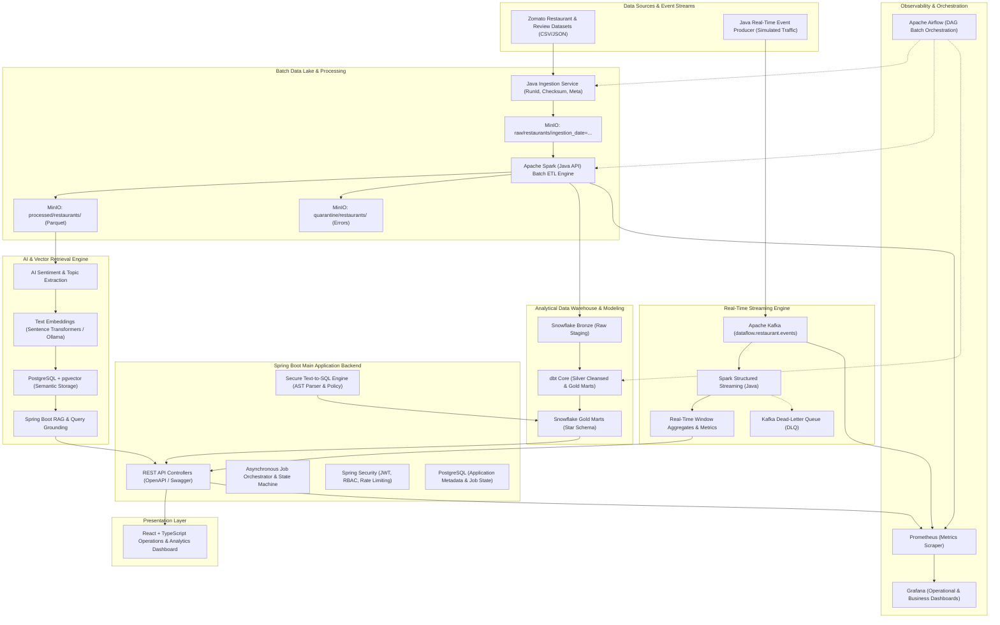

# DataFlow System Architecture & Engineering Blueprint

This document details the architecture, design principles, component responsibilities, distributed data flow, security model, and interview-ready rationales for the **DataFlow** Real-Time Distributed Data Pipeline and Analytics Platform.

---

## 1. High-Level Architecture Overview

DataFlow implements a hybrid **Lambda/Medallion Architecture** that unifies high-throughput batch ETL, low-latency streaming event processing, vector-based semantic retrieval (RAG), and a secure Natural-Language-to-SQL analytics engine.

---

## 2. Core Architectural Subsystems

### A. Batch Data Lake & ETL (Medallion Pattern)
1. **Raw Zone (`raw/`)**: Original files uploaded by the Java Ingestion Service. Guaranteed immutable; files are organized by ingestion date and run ID (`raw/restaurants/ingestion_date=YYYY-MM-DD/run_id=<uuid>/`).
2. **Processed Zone (`processed/`)**: Normalized, cleansed, and partitioned Parquet files generated by Apache Spark. Snappy-compressed, columnar storage optimized for analytical reads.
3. **Quarantine Zone (`quarantine/`)**: Defective or corrupt records rejected by Spark Data Quality gates. Each record contains original raw payload, failure reason, error code, and rejection timestamp.

### B. Real-Time Streaming Subsystem
1. **Event Producer**: High-throughput Java Kafka producer generating order, review, and rating events with deterministic schema validation and partition keys (`restaurant_id`).
2. **Partitioning Strategy**: Partitioned by `restaurant_id` to guarantee in-order delivery of events per restaurant while distributing load evenly across broker partitions.
3. **Spark Structured Streaming**: Processes micro-batches (e.g. 5-second trigger), applies event-time watermarking (10-minute watermark) to handle late-arriving events, and writes tumbling/sliding window aggregates.
4. **Dead-Letter Queue (DLQ)**: Malformed JSON or unparseable events are routed to `dataflow.restaurant.dlq` without blocking the streaming consumer group.

### C. AI Sentiment, Embedding & RAG Pipeline
1. **Sentiment & Entity Extraction**: Background processor analyses review text using Ollama (local Llama 3.2) or hosted models, extracting sentiment score (`-1.0` to `+1.0`), category (`POSITIVE`, `NEUTRAL`, `NEGATIVE`), and mentioned food/service aspects.
2. **Vector Embeddings**: Generates dense vector representations (e.g., 768 or 1536 dimensions) for review chunks.
3. **pgvector Storage**: Reviews and vectors are stored in PostgreSQL with HNSW or IVFFlat index for sub-millisecond approximate nearest neighbor (ANN) cosine similarity search.
4. **Retrieval-Augmented Generation (RAG)**: When a user asks natural-language questions (e.g. *"What do customers say about pasta at Indiranagar cafes?"*), the top-$K$ semantic matches are retrieved from pgvector, injected into the LLM context with strict grounding prompts, and returned with explicit source review citations.

### D. Secure Text-to-SQL Architecture
1. **Input Normalization & Intent Verification**: User prompt is checked for SQL query intent.
2. **Schema-Constrained Generation**: Prompt provides only approved read-only view schemas (`ZOMATO.MARTS`).
3. **AST Parsing & Security Gate**: JSqlParser / SQL AST parser inspects the candidate SQL before execution:
   - Prohibits non-`SELECT` statements (`INSERT`, `UPDATE`, `DELETE`, `DROP`, `ALTER`, `TRUNCATE`, `EXEC`, `CREATE`).
   - Prohibits multi-statement execution (semicolons separating queries).
   - Enforces table and column whitelisting (only analytical marts, no internal metadata or user tables).
   - Limits maximum return rows (`LIMIT 100` appended if missing).
4. **Read-Only Database Role**: Executed under a dedicated Snowflake / PostgreSQL user with `SELECT`-only privileges and strict statement timeouts (e.g. 5 seconds).

### E. Orchestration with Apache Airflow
- Coordinates the end-to-end batch flow:
  `Source Validation -> Java Ingestion -> MinIO Lake Check -> Spark Batch ETL -> Data Quality Gate -> Snowflake COPY -> dbt Run & Test -> Verification`.
- Implements exponential backoff retries, SLA alerts, and failure notifications.

---

## 3. Technology Selection & Trade-Off Analysis (Interview Deep-Dive)

### 1. Why Apache Spark (Java API) instead of pure Java Collections?
- **Java Streams/Collections**: Bound to a single JVM's heap memory. Fails with `OutOfMemoryError` on large datasets (e.g., 5M+ rows). Single-machine vertical scaling only.
- **Apache Spark**: Distributed execution engine with memory management (Tungsten project), off-heap memory, disk spilling, partition-aware shuffles, cost-based optimizer (Catalyst), and horizontal scalability across cluster nodes.
- **Java API Choice**: Enables strict static typing, seamless integration with the Spring Boot backend ecosystem, unified JVM build artifacts (Maven), and eliminates language context switching.

### 2. Why Snowflake for Analytical Warehousing vs PostgreSQL for App Data?
- **PostgreSQL**: Row-oriented relational database (OLTP). Optimized for single-row lookups, atomic ACID transactions, foreign keys, and application state. Degrades on heavy analytical aggregations (`SUM`, `AVG`, `GROUP BY` across millions of rows).
- **Snowflake**: Column-oriented cloud data warehouse (OLAP). Data is micro-partitioned and stored column-by-column. An aggregation query over `aggregate_rating` scans only that specific column file, minimizing I/O and vectorizing CPU instructions. Features separation of compute and storage.
- **Separation of Concerns**: PostgreSQL owns transactional state (users, pipeline jobs, audit logs, vector embeddings); Snowflake owns large-scale analytical facts and dimensions.

### 3. Kafka vs RabbitMQ
- **RabbitMQ**: Message broker designed for complex routing (exchanges, topic patterns, AMQP) with messages removed upon consumption acknowledgement. Scales poorly with multi-gigabyte backlogs or stream replaying.
- **Apache Kafka**: Distributed append-only commit log. Messages are retained on disk for a configured retention period. Consumers track their own offsets, allowing multiple independent consumer groups to read at different rates and replay historical events from any offset. Capable of millions of events per second with high partition parallelism.

---

## 4. Local vs Cloud Resource Budget

| Subsystem | Service | Deployment Mode | Memory Budget | CPU Allocation | Cost / Account |
|-----------|---------|-----------------|---------------|----------------|----------------|
| Ingestion & Backend | Spring Boot (Java 21) | Local / Docker | 512 MB - 1 GB | 1 core | Free (Local) |
| Object Storage | MinIO | Docker | 256 MB - 512 MB | 0.5 core | Free (Local) |
| App Database & Vector | PostgreSQL + pgvector | Docker | 512 MB - 1 GB | 1 core | Free (Local) |
| Real-Time Streaming | Kafka + Zookeeper/KRaft | Docker | 1 GB - 1.5 GB | 1 core | Free (Local) |
| Processing Engine | Apache Spark (Local Mode) | Local JVM / Docker | 1 GB - 2 GB | 2 cores | Free (Local) |
| Orchestration | Apache Airflow | Docker (Optional) | 1.5 GB | 1 core | Free (Local) |
| Metrics & Dashboards | Prometheus & Grafana | Docker | 256 MB - 512 MB | 0.5 core | Free (Local) |
| Web Dashboard | React + TypeScript | Local / Nginx | 128 MB | 0.5 core | Free (Local) |
| AI LLM & Embeddings | Ollama (Local) / Cloud | Local / Hosted API | 2 GB - 4 GB | 2 cores / GPU | Free (Local Ollama) |
| Analytical Warehouse | Snowflake | Cloud Managed | 0 MB Local | 0 Cores Local | Cloud (Free Trial / Controlled XS WH) |

> **Cost Guardrail for Snowflake**: The project is architected with a local mock/fallback mode (DuckDB or PostgreSQL Staging) so the entire application can run 100% locally with zero cloud spend. When Snowflake is connected, the warehouse is configured to `X-Small` with `AUTO_SUSPEND = 60` seconds and strict resource monitors to prevent unintended billing.
